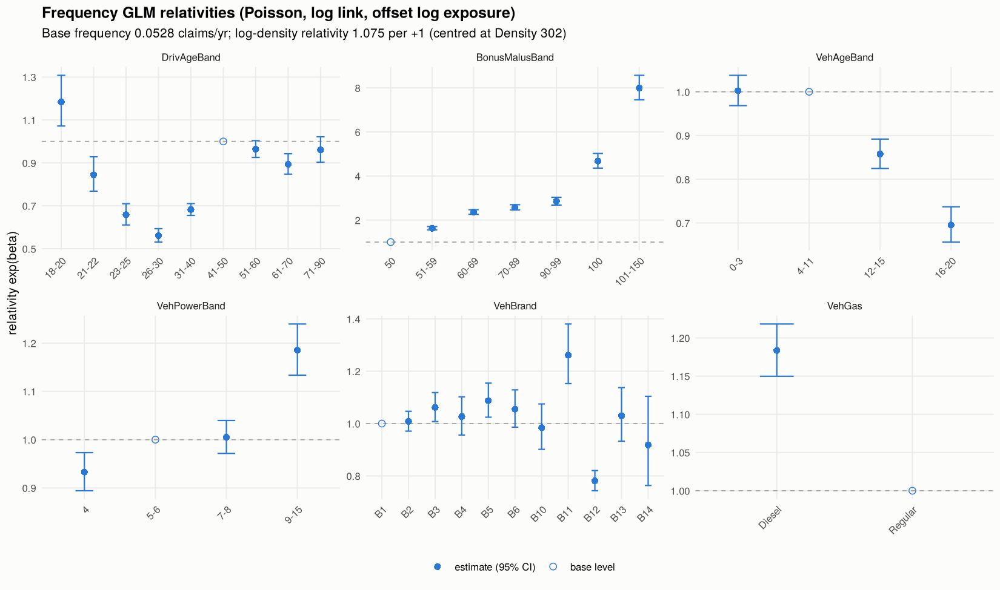
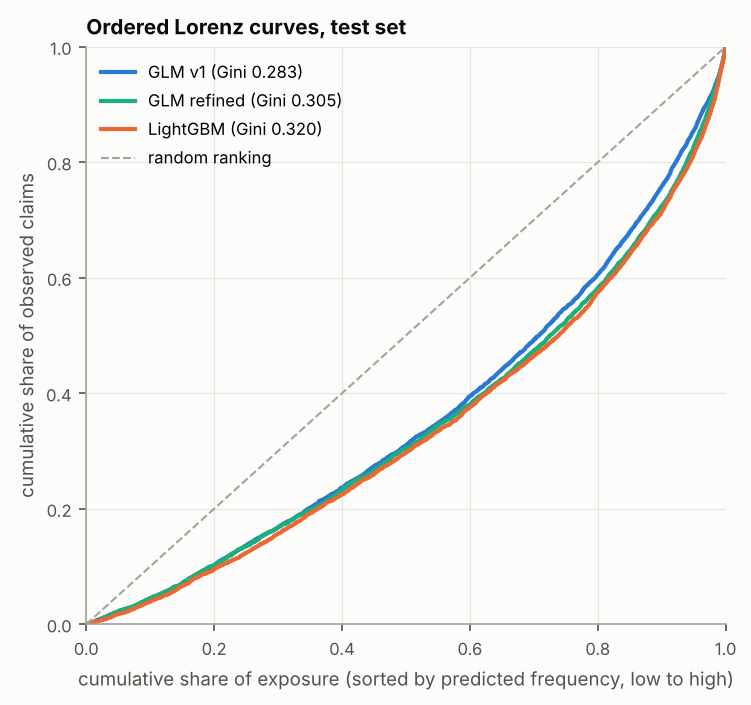
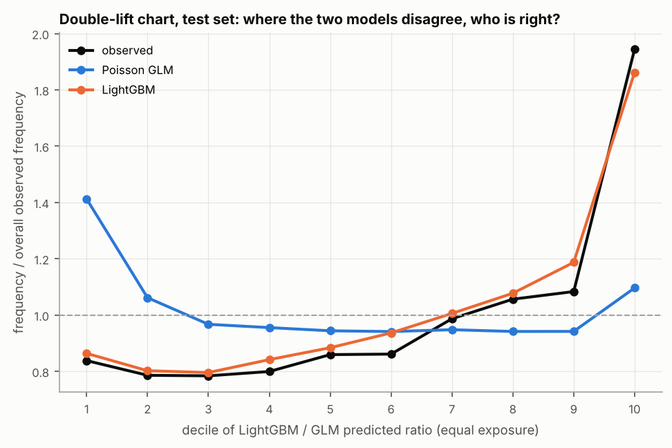
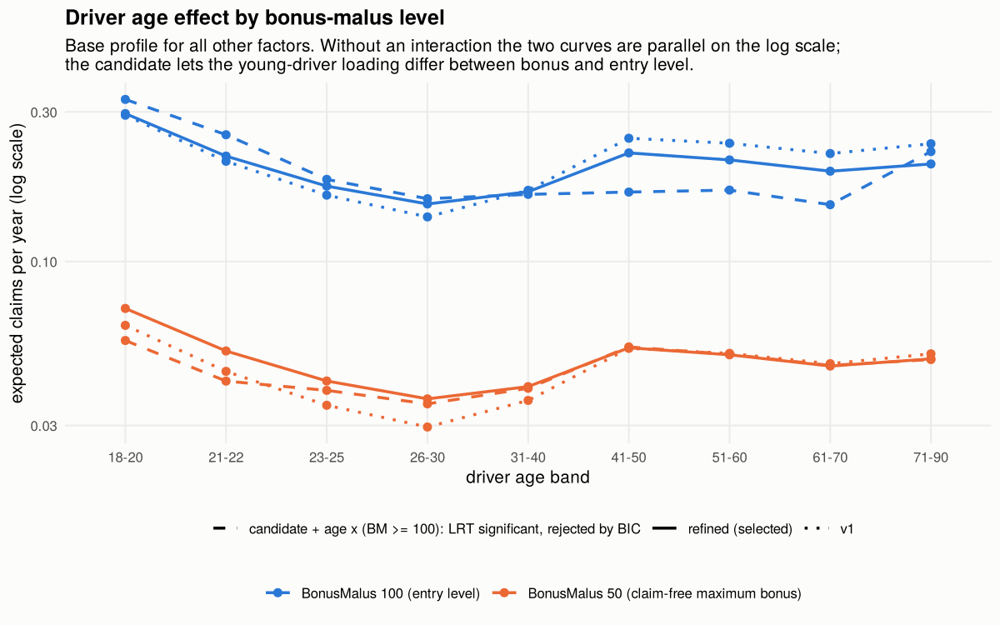

# Motor TPL technical pricing: GLM tariff vs gradient boosting

Frequency-severity pricing of French motor third-party liability (freMTPL2, 678k policies):
a Poisson / Gamma GLM tariff in **R** with relativities and statistical variable selection, benchmarked
against a LightGBM Poisson model in **Python** on a held-out test set, then refined using what the GBM found
and validated with 5-fold cross-validation and a paired bootstrap.

## Business problem

A motor insurer needs a **technical (risk) premium** for every policyholder: the expected annual claim
cost given the rating factors. The standard actuarial approach splits it into

    pure premium = E[claim count per year] x E[claim size] x large-loss loading

and models each part with a GLM. GLMs give a multiplicative tariff (base premium x one relativity per
rating factor) that underwriters, regulators and pricing committees can read, challenge and file.
Machine-learning models usually rank risks better but are harder to explain and to turn into a
tariff. This project builds the GLM tariff end to end and quantifies what is given up against a GBM.

## Data

- **freMTPL2freq**: 677,991 motor TPL policies observed mostly within one year: exposure, claim count,
  driver age, bonus-malus, vehicle age / power / brand / fuel, area, population density, region.
- **freMTPL2sev**: 26,444 individual claim amounts, linked by `IDpol`.
- Source: R package **CASdatasets** (Dutang & Charpentier), GitHub mirror
  <https://github.com/dutangc/CASdatasets>, license **GPL (>= 2)**. In this version the policy claim
  counts are consistent with the severity file (each of the 24,944 policies with claims has exactly
  `ClaimNb` claim records).
- The data are **not committed**. `Rscript data/download_data.R` downloads the `.rda` files from
  `raw.githubusercontent.com/dutangc/CASdatasets/master/data/` and converts them to CSV in `data/raw/`.

## Approach

**1. Cleaning (Python, `src/cleaning.py`).** Caps fixed a priori from the one-way tables, not fitted:
ClaimNb at 4 (8 policies with 5-16 claims in under a year: data error or fleet), Exposure at 1 year (1,224;
annual contracts), VehAge at 20 (8,321), DrivAge at 90 (401) and BonusMalus at 150 (209): thin, noisy tails
with high leverage. Density spans 1 to 27,000 inhabitants/km2 and enters as `log(Density)`.

**2. Large claims.** Individual claims are capped at the 99.5% quantile of the **training** claims
(EUR 34,966). The 107 training claims above it (0.5% of claims) carry 28.4% of the incurred cost
(EUR 50.5m incurred vs 36.1m capped). The severity GLM is fitted on capped amounts, so that a few
claims of up to EUR 4m do not drive the relativities, and the excess is spread back with a flat
**large-loss loading = incurred / capped = 1.396**. A flat loading assumes large losses are not related
to the rating factors, a common simplification when there are too few of them to model.

**3. Split.** 80/20 random split **by policy** (`IDpol`, seed 42), so all claims of a policy are on the
same side. Cap and loading are estimated on train only. Train: 542,393 policies, 286,905 exposure years,
21,227 claims (frequency 0.0740). Test: 135,598 policies, 71,438 years, 5,178 claims (0.0725).

**4. Banding from one-way analyses.** For each factor the observed frequency (claims / exposure) by raw
value is compared with its exposure; adjacent values with similar frequency or thin exposure are merged
(`src/features.py`). Blue dots = raw values, orange steps = chosen bands:


Examples: drivers 18-20 have about 3x the average frequency and need their own band; the vehicle-age
curve stays between 0.07 and 0.08 up to 11 years and then falls; vehicle power 5-6 and 7-8 behave alike. Density, area,
fuel and brand one-ways are in [`oneway_other.png`](reports/figures/oneway_other.png).

**5. Frequency GLM (R, `R/fit_glm.R`).** Poisson, log link, offset `log(Exposure)`, base level of each
factor = level with the most exposure. Policies with identical rating factors are aggregated into
221,740 cells (summed claims and exposure): for a Poisson GLM this gives exactly the same estimates,
standard errors and likelihood-ratio statistics as the policy-level fit (checked in the R tests) and
cuts the run time. Variable selection: backward elimination with likelihood-ratio tests (alpha = 5%).

**6. Severity GLM (R).** Gamma, log link, response = average capped claim per policy, **prior weight =
number of claims** (the variance of an average of n claims is proportional to 1/n). Because the Gamma
dispersion is estimated, terms are tested with F tests using the Pearson dispersion.

**7. GBM benchmark (Python, `src/gbm.py`).** LightGBM with Poisson objective, target = claim count,
`init_score = log(Exposure)` (the boosting analogue of the GLM offset), raw capped variables instead of
bands. Grid of 6 settings (`num_leaves` x `min_data_in_leaf`) with early stopping on a policy-level
validation split of the training set; refit on the full training set. The test set is used once.

**8. Evaluation (Python, `src/evaluate.py`).** Test set: Poisson deviance, ordered Lorenz curve and Gini,
double-lift chart, balance of claim counts and of the pure premium.

**9. GBM-informed refinement (R, `R/fit_freq_extensions.R`).** The double lift and SHAP (below) show that
the GBM wins on single bonus-malus values. Under the French bonus-malus rule each claim-free year multiplies
the coefficient by 0.95 (truncated, floor 0.50), so from 100 only 100, 95, 90, 85, 80, 76, ..., 51, 50 can be
reached without a claim. Any other value below 100 implies a recent malus. This gives one deterministic flag,
`BMOffLadder` (`src/features.py`). On top of it: natural splines (`splines::ns`) in place of the age and
bonus-malus bands, as a check of the banding, and three interactions tested by likelihood-ratio tests. An
interaction is kept only if its quasi-Poisson LR p-value is < 1% **and** it lowers BIC. With 540k policies an
LR test finds almost any effect "significant", so BIC is used as a guard on the number of tariff cells.

**10. Poisson vs quasi-Poisson vs negative binomial.** On the refined terms, `MASS::glm.nb` (NB2,
Var = mu + mu^2/theta) is compared with the Poisson fit on AIC, test deviance, relativities and balance.

**11. Stability (Python, `src/validation.py`).** 5-fold cross-validation on the training set (folds by
policy): every GLM is refitted on 4 folds in R and LightGBM in Python, with the same terms and
hyper-parameters, and both are scored on the held-out fold. On the test set, a **paired bootstrap** (1,000
resamples of policies, every model scored on the same resample) gives a 95% interval for the Gini gap.

**Tweedie check (R).** As a single-model alternative, a Tweedie (compound Poisson-Gamma) GLM is fitted
directly on capped claim cost per exposure year (weights = exposure, log link, power p = 1.5 fixed, not
estimated), using the `Tweedie` family of `mgcv`, a recommended package that ships with R.

## Results

All numbers below are produced by `make all` and written to `reports/tables/`.

### Frequency GLM: variable selection and overdispersion

Backward elimination removed only **Area** (LR test p = 0.14): Area is a coarse grouping of density,
and once log-density is in the model it adds nothing. In the final model every remaining term is
significant (largest p-value: Region, 2e-26).

Train diagnostics (policy level): Pearson dispersion 1.73; Cameron-Trivedi overdispersion test
alpha = 0.65 (t = 1.72, one-sided p = 0.043); fitted vs observed claims 21,227.0 vs 21,227.
There is mild evidence of overdispersion. Re-running the LR tests as quasi-Poisson tests (deviance
increase divided by 1.73) leads to the same selection: Area p = 0.44, all retained terms p < 1e-10.
The 95% intervals in the relativity table are Poisson-based and should be widened by about
sqrt(1.73) = 1.31 under a quasi-Poisson view. The balance line is the GLM property expected with a
canonical link and an intercept: total fitted claims equal total observed claims on the training data.



Selected frequency relativities (base frequency 0.0528 claims/year at the base profile; full table in
`freq_glm_relativities.csv`):

| Factor | Level | Relativity | 95% CI |
|---|---|---:|---|
| BonusMalus | 50 (base) | 1.00 | |
| BonusMalus | 100 (new drivers start at 100) | 4.68 | 4.36-5.02 |
| BonusMalus | 101-150 | 7.99 | 7.46-8.57 |
| DrivAge | 18-20 vs 41-50 | 1.18 | 1.07-1.31 |
| VehAge | 16-20 vs 4-11 | 0.69 | 0.66-0.74 |
| VehGas | Diesel vs Regular | 1.18 | 1.15-1.22 |
| log(Density) | per +1 (x 2.7 density) | 1.075 | 1.066-1.084 |

Bonus-malus dominates. The young-driver relativity is much smaller than the one-way (3x) because
BonusMalus already captures most of the novice effect (new drivers start at 100).

**Severity GLM.** The F-test elimination dropped VehBrand, VehGas and log-density; it kept driver age,
vehicle age, bonus-malus, vehicle power, region and area. The effects are much flatter than for
frequency (e.g. drivers 18-20: 1.28, BM 100: 1.36), and the Pearson dispersion is 3.5, so a claim
amount has a coefficient of variation of about 1.9 even after capping. On the **test** claims
the mean predicted capped severity is EUR 1,699 vs EUR 1,673 observed (ratio 1.016).

### GLM vs GBM on the test set (135,598 policies)

| Model | Mean Poisson deviance | Deviance explained vs null | Gini | Predicted / observed claims |
|---|---:|---:|---:|---:|
| Null (train mean frequency) | 0.2475 | 0.0% | 0.000 | 1.021 |
| Poisson GLM v1 (R) | 0.2364 | 4.5% | 0.283 | 1.021 |
| Poisson GLM refined (R, + BM history flag) | 0.2337 | 5.6% | 0.305 | 1.020 |
| Negative binomial GLM refined (R) | 0.2337 | 5.5% | 0.305 | 1.022 |
| LightGBM Poisson (Python) | **0.2320** | **6.3%** | **0.320** | 1.026 |

Low "deviance explained" is normal for claim counts (most policies have no claim). All models, including
the null, over-predict test claims by about 2%: the test frequency is lower (0.0725 vs 0.0740), not a bias.

<p float="left">
  
  
</p>

The **double-lift chart** sorts test policies by the ratio GBM / GLM. In the deciles where the models
disagree, the observed frequency follows the GBM: in the top decile (GBM 34% to 60x above the GLM)
the observed frequency is 1.94x the average, the GBM predicts 1.86x and the GLM 1.10x. One driver is
visible in the one-way plot: single bonus-malus values have very different frequencies inside the same
band. BonusMalus = 62 is 6.9% of the top decile but 0.3% of the other deciles; BonusMalus = 58 is 5.4%
vs 0.3%. The GBM uses each value, the GLM only the band average. SHAP ranks BonusMalus first, then
driver age and density ([`gbm_shap_summary.png`](reports/figures/gbm_shap_summary.png)). Values 62 and 58 are
exactly the values that cannot be reached claim-free, which led to the refinement below.

**Robustness check.** 33% of test policies have a rating profile identical to some training policy
(freMTPL2 contains the same risk across several contract periods). The GBM keeps its advantage on test
policies **without** such a twin (Gini 0.341 vs 0.301 for GLM v1 and 0.328 for the refined GLM), so the
gain is not an artefact of near-duplicates leaking across the split.

### GBM-informed GLM refinement

Observed training frequency below BM 100, by band and flag (`notebooks/walkthrough.ipynb`): in band 60-69,
0.068 for drivers on the claim-free ladder vs 0.203 off it; in band 51-59, 0.052 vs 0.120. Refinement steps
(fitted on train; selection uses train criteria only, test columns are for information):

| Step (vs previous) | Params | LR (df), quasi-Poisson p | BIC | Test deviance | Test Gini |
|---|---:|---|---:|---:|---:|
| v1: bands | 54 | | 172,327 | 0.2364 | 0.283 |
| + `BMOffLadder` (**kept**) | 55 | 1,220 (1), p < 1e-150 | **171,120** | 0.2337 | 0.305 |
| DrivAge spline instead of bands (check) | 56 | non-nested | 171,066 | 0.2336 | 0.306 |
| BonusMalus spline instead of bands (check) | 56 | non-nested | 171,126 | 0.2336 | 0.307 |
| + DrivAge x BonusMalus bands | 103 | 271 (48), p = 4e-13 | 171,482 | 0.2335 | 0.307 |
| + DrivAge x (BonusMalus >= 100) | 63 | 60 (8), p = 4e-5 | 171,166 | 0.2336 | 0.305 |
| + VehAge x VehGas | 58 | 11 (3), p = 0.11 | 171,149 | 0.2337 | 0.305 |

The flag costs one parameter and has relativity **2.29** (quasi-Poisson 95% CI 2.16-2.43): at the same
bonus-malus band, a driver carrying a recent malus has more than twice the frequency. The splines gain at
most 0.002 Gini, so the bands are adequate and the tariff stays a table. Both age x bonus-malus interactions
are significant by LR test but rejected by BIC; the test set confirms they add little (+0.0004 to +0.0023
Gini). The refined model is v1 + flag. It closes **60% of the deviance gap and 58% of the Gini gap** between
GLM v1 and LightGBM on the test set (`gap_closed.csv`).



### Poisson, quasi-Poisson or negative binomial?

| Refined terms, train | Poisson | quasi-Poisson | Negative binomial |
|---|---:|---:|---:|
| Dispersion / theta | 1 | Pearson phi = 1.77 | theta = 1.62 (SE 0.13) |
| AIC | 170,503 | n/a | **170,275** |
| Fitted / observed claims (train) | 1.0000 | 1.0000 | 1.0026 |
| Test mean deviance | 0.23371 | 0.23371 | 0.23373 |
| Test Gini | 0.3047 | 0.3047 | 0.3051 |

The NB fits the training likelihood better (LR = 230 for theta), but its relativities differ from the
Poisson ones by at most 1.2% (median 0.2%) and the test metrics are the same. With frequencies around
0.07 the NB variance mu + mu^2/1.62 is only about 2% above the Poisson one for an average policy, while
the Pearson dispersion is 1.77: the overdispersion is concentrated in a few large Pearson residuals, which
the quasi-Poisson correction (standard errors x 1.33) covers more conservatively. **Final choice: Poisson
estimates with quasi-Poisson standard errors.** Poisson estimates stay consistent when the variance is
misspecified, and the Poisson keeps exact balance on the training data.

### How stable is the GLM-GBM gap?

5-fold cross-validation on the training set (`cv_folds.csv`, `cv_summary.csv`):

| Model | Deviance, mean (sd) | Gini, mean (sd) | Gini gap LightGBM - model, mean (sd) | Folds where LightGBM wins |
|---|---:|---:|---:|---:|
| GLM v1 | 0.2414 (0.0029) | 0.298 (0.005) | 0.030 (0.006) | 5 / 5 |
| GLM refined | 0.2391 (0.0029) | 0.318 (0.009) | 0.010 (0.002) | 5 / 5 |
| LightGBM | 0.2376 (0.0030) | 0.328 (0.010) | | |

Paired bootstrap on the test set (1,000 resamples, `bootstrap_gini_gap.csv`):

| Gini gap | Test estimate | 95% interval |
|---|---:|---|
| LightGBM - GLM v1 | 0.037 | 0.029 to 0.046 |
| LightGBM - GLM refined | 0.016 | 0.008 to 0.023 |
| GLM refined - GLM v1 | 0.021 | 0.016 to 0.027 |

The fold-to-fold sd of each model's Gini (about 0.01) is much larger than the sd of the paired gap (0.002
for the refined GLM): folds differ in how easy they are, but the ranking of the models does not change. The
refined GLM is clearly better than v1 and LightGBM still ranks risks better than either, by a smaller and
still significant margin. Caveat: bands, GLM terms and GBM hyper-parameters were chosen on the whole
training set, so the CV numbers are slightly optimistic for all models; the test set is the clean comparison.

### Tariff example and portfolio balance

Multiplicative build-up of the GLM v1 pure premium for three profiles (`tariff_examples.csv`; the
product of the factors is checked against `predict()` in the code):

| | A: experienced, urban | B: young new driver | C: senior, rural |
|---|---|---|---|
| Profile | 41-50 y, BM 50, Diesel, Ile-de-France, 3,000/km2 | 18-20 y, BM 100, car 12-15 y, Rhone-Alpes, 800/km2 | 71-90 y, BM 50, car 0-3 y, Bretagne, 60/km2 |
| Base frequency | 0.0528 | 0.0528 | 0.0528 |
| x relativities | Diesel 1.18, density 1.18, region 0.95 | BM 4.68, age 1.18, region 1.20, brand 0.78, ... | density 0.89, age 0.96, ... |
| **Expected frequency** | 0.0705 | 0.2524 | 0.0456 |
| **Expected capped severity** | EUR 1,510 | EUR 2,503 | EUR 2,177 |
| x large-loss loading | 1.396 | 1.396 | 1.396 |
| **Pure premium / year** | **EUR 149** | **EUR 882** | **EUR 138** |

**Frequency x severity vs Tweedie** (test set, capped claim cost, loading divided out): Gini on claim
cost 0.301 vs 0.305, mean Tweedie deviance (p = 1.5) 69.10 vs 69.08, predicted / actual capped cost 1.037
vs 1.044: practically equivalent. The frequency-severity split is kept as the main
tariff because it shows *why* a risk is expensive (more claims or bigger claims) and lets each part
have its own rating factors.

**Portfolio balance on the test set.** Predicted GLM pure premium x exposure EUR 12.56m vs actual capped
claims x loading 1.396 = EUR 12.11m (ratio 1.037) and actual incurred claims EUR 9.46m (ratio 1.327).
At the capped level the tariff is within 4% of the test experience. Against incurred claims it is 33%
too high, because the test year had few very large claims: its own incurred/capped ratio is 1.09 vs
1.40 on train. The large-loss loading is the most volatile part of the premium. In practice it would be
set from many years of data or an extreme-value (e.g. generalised Pareto) fit, not from one sample.
The tariff and balance tables above use the v1 frequency GLM; the refined model's build-up is in
`freq_refined_tariff_examples.csv` (e.g. profile B: expected frequency 0.267 instead of 0.252).

## Key takeaways

- **GLM**: a transparent tariff (base x relativities) with likelihood-ratio evidence for every factor,
  exact balance on the training data, and a structure that can be filed, explained to underwriters
  and constrained (monotone bonus-malus, smoothed age curve).
- **GBM**: better risk ranking (Gini 0.320 vs 0.283, lower test deviance) because it uses the raw values
  and interactions. Not balanced by construction (train fitted / observed = 1.007) and not a tariff;
  explaining one premium needs SHAP, not a table.
- **GBM as a diagnostic works**: the double lift pointed at bonus-malus values off the claim-free
  ladder; one interpretable flag closed about 60% of the gap. The remaining Gini gap (0.016 on test,
  95% CI 0.008-0.023) is the price of the transparent tariff.
- Poisson vs negative binomial is a question about standard errors here, not about the tariff.

## Limitations and next steps

- Rating factors are only those in freMTPL2: no claim history beyond bonus-malus, no usage or mileage.
- Banding was chosen by inspecting one-way plots on the training set. A more formal approach would be
  GAM smoothing or fused-lasso grouping of levels.
- `BMOffLadder` relies on the French bonus-malus rule; it would mislabel drivers who transferred from
  another insurer or system with a non-standard coefficient. A real tariff would use the claim history directly.
- Interactions rejected by BIC might be worth keeping with credibility or penalised (ridge / lasso) estimates.
- The bootstrap resamples policies, not years: it does not capture year-to-year (e.g. inflation or
  large-loss) variation.
- Flat large-loss loading estimated from one sample; Tweedie power fixed at 1.5 rather than profiled.
- Pure premium only: no expenses, commission, profit or reinsurance loading, so this is not a commercial premium.

## How to run

Requirements: Python 3.13 with `requirements.txt`, R 4.3 with `data.table`, `ggplot2`, `testthat`
(plus `MASS`, `splines` and `mgcv`, which ship with standard R installations).

```bash
pip install -r requirements.txt
make all        # download (if missing) -> prepare -> one-ways -> R GLMs -> LightGBM -> evaluation -> CV
make test       # pytest (23 tests) + testthat (36 expectations), the same commands CI runs
make notebook   # re-execute notebooks/walkthrough.ipynb (needs the pipeline outputs)
```

`make all` is equivalent to `python -m src.pipeline`. Run time measured here: 455 s (about 7.6 minutes) on
a shared 2-CPU machine (R GLMs 140 s, R refinement / NB / CV fits 158 s, LightGBM 92 s, CV and bootstrap
49 s; `reports/tables/runtime.csv`). LightGBM uses one thread: on the shared machine, two were slower.
GitHub Actions (`.github/workflows/ci.yml`) runs pytest and testthat on small simulated fixtures; the
workflow file was written and its commands checked locally, but it has not been run on GitHub.

## Project structure

```
data/download_data.R     fetch freMTPL2 .rda from CASdatasets on GitHub, convert to CSV
src/config.py            paths, seed, cleaning caps
src/cleaning.py          caps, log-density, large-claim cap and loading, severity join, policy split, CV folds
src/features.py          GLM bands, bonus-malus claim-free ladder flag
src/prepare.py           stage 1: build train/test CSVs
src/oneway.py            one-way tables and plots (training data)
R/glm_functions.R        LR/F term tests, backward selection, relativities, cell-aggregated Poisson fits
R/fit_glm.R              stage 2: Poisson frequency, Gamma severity and Tweedie GLMs, tariff build-up
R/fit_freq_extensions.R  stage 2b: BM flag, splines, interactions, negative binomial, CV refits
src/gbm.py               stage 3: LightGBM Poisson with log-exposure init score, tuning, SHAP
src/metrics.py           Poisson deviance, Lorenz curve, Gini, double lift
src/evaluate.py          stage 4: test-set comparison and balance checks
src/validation.py        stage 5: 5-fold CV of GLM vs LightGBM, paired bootstrap of the Gini gap
src/pipeline.py          single entry point
tests/                   pytest (cleaning, banding, metrics, validation) and testthat (R helpers)
notebooks/walkthrough.ipynb  executed walkthrough that imports from src/
.github/workflows/ci.yml     CI: pytest + testthat
reports/figures, tables  all outputs quoted in this README
```

## License

Code: MIT (see `LICENSE`). Data: CASdatasets, GPL (>= 2); not redistributed here.
