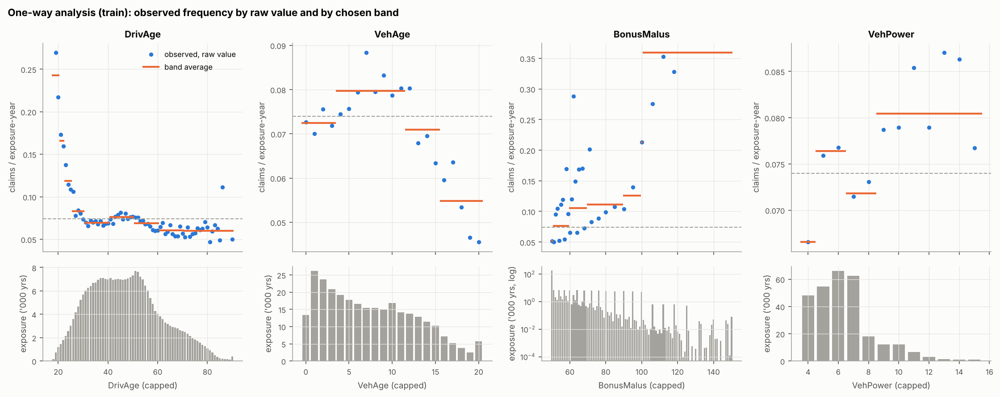

# Motor TPL technical pricing: GLM tariff vs gradient boosting

Frequency-severity pricing of French motor third-party liability (freMTPL2, 678k policies):
a Poisson / Gamma GLM tariff in **R** with relativities and statistical variable selection, benchmarked
against a LightGBM Poisson model in **Python** on a held-out test set.

## Business problem

A motor insurer needs a **technical (risk) premium** for every policyholder: the expected annual claim
cost given the rating factors. The standard actuarial approach splits it into

    pure premium = E[claim count per year] x E[claim size] x large-loss loading

and models each part with a GLM. GLMs give a multiplicative tariff (base premium x one relativity per
rating factor) that underwriters, regulators and pricing committees can read, challenge and file.
Machine-learning models usually rank risks better but are harder to explain and to turn into a
tariff. This project builds the GLM tariff end to end and quantifies what is given up against a GBM.

## Data

- **freMTPL2freq**: 677,991 motor TPL policies observed mostly within one year: exposure, claim count,
  driver age, bonus-malus, vehicle age / power / brand / fuel, area, population density, region.
- **freMTPL2sev**: 26,444 individual claim amounts, linked by `IDpol`.
- Source: R package **CASdatasets** (Dutang & Charpentier), GitHub mirror
  <https://github.com/dutangc/CASdatasets>, license **GPL (>= 2)**. In this version the policy claim
  counts are consistent with the severity file (each of the 24,944 policies with claims has exactly
  `ClaimNb` claim records).
- The data are **not committed**. `Rscript data/download_data.R` downloads the `.rda` files from
  `raw.githubusercontent.com/dutangc/CASdatasets/master/data/` and converts them to CSV in `data/raw/`.

## Approach

**1. Cleaning (Python, `src/cleaning.py`).** Caps are fixed a priori from the one-way tables, not fitted:

| Rule | Policies affected | Reason |
|---|---:|---|
| ClaimNb capped at 4 | 8 | 5-16 claims within a year: data error or fleet; would dominate the Poisson likelihood |
| Exposure capped at 1 year | 1,224 | annual contracts; exposure > 1 is a recording error |
| VehAge capped at 20 | 8,321 | thin and noisy tail (one-way plot) |
| DrivAge capped at 90 | 401 | thin tail |
| BonusMalus capped at 150 | 209 | thin tail, extreme leverage |

Density spans 1 to 27,000 inhabitants/km2, so it enters as `log(Density)`; the one-way shows an almost
linear frequency trend on that scale.

**2. Large claims.** Individual claims are capped at the 99.5% quantile of the **training** claims
(EUR 34,966). The 107 training claims above it (0.5% of claims) carry 28.4% of the incurred cost
(EUR 50.5m incurred vs 36.1m capped). The severity GLM is fitted on capped amounts, so that a few
claims of up to EUR 4m do not drive the relativities, and the excess is spread back with a flat
**large-loss loading = incurred / capped = 1.396**. A flat loading assumes large losses are not related
to the rating factors, a common simplification when there are too few of them to model.

**3. Split.** 80/20 random split **by policy** (`IDpol`, seed 42), so all claims of a policy are on the
same side. Cap and loading are estimated on train only.

| set | policies | exposure (years) | claims | frequency |
|---|---:|---:|---:|---:|
| train | 542,393 | 286,905 | 21,227 | 0.0740 |
| test | 135,598 | 71,438 | 5,178 | 0.0725 |

**4. Banding from one-way analyses.** For each factor the observed frequency (claims / exposure) by raw
value is compared with its exposure; adjacent values with similar frequency or thin exposure are merged
(`src/features.py`). Blue dots = raw values, orange steps = chosen bands:



Examples: drivers 18-20 have about 3x the average frequency and need their own band; the vehicle-age
curve stays between 0.07 and 0.08 up to 11 years and then falls; vehicle power 5-6 and 7-8 behave alike. Density, area,
fuel and brand one-ways are in [`oneway_other.png`](reports/figures/oneway_other.png).

**5. Frequency GLM (R, `R/fit_glm.R`).** Poisson, log link, offset `log(Exposure)`, base level of each
factor = level with the most exposure. Policies with identical rating factors are aggregated into
221,740 cells (summed claims and exposure): for a Poisson GLM this gives exactly the same estimates,
standard errors and likelihood-ratio statistics as the policy-level fit (checked in the R tests) and
cuts the run time. Variable selection: backward elimination with likelihood-ratio tests (alpha = 5%).

**6. Severity GLM (R).** Gamma, log link, response = average capped claim per policy, **prior weight =
number of claims** (the variance of an average of n claims is proportional to 1/n). Because the Gamma
dispersion is estimated, terms are tested with F tests using the Pearson dispersion.

**7. GBM benchmark (Python, `src/gbm.py`).** LightGBM with Poisson objective, target = claim count,
`init_score = log(Exposure)` (the boosting analogue of the GLM offset), raw capped variables instead of
bands. Grid of 6 settings (`num_leaves` x `min_data_in_leaf`) with early stopping on a policy-level
validation split of the training set; refit on the full training set. The test set is used once.

**8. Evaluation (Python, `src/evaluate.py`).** On the test set: Poisson deviance, ordered Lorenz curve
and Gini index, double-lift chart, portfolio balance of claim counts and of the pure premium.

**Tweedie check (R).** As a single-model alternative, a Tweedie (compound Poisson-Gamma) GLM is fitted
directly on capped claim cost per exposure year (weights = exposure, log link, power p = 1.5 fixed, not
estimated), using the `Tweedie` family of `mgcv`, a recommended package that ships with R.

## Results

All numbers below are produced by `make all` and written to `reports/tables/`.

### Frequency GLM: variable selection and overdispersion

Backward elimination removed only **Area** (LR test p = 0.14): Area is a coarse grouping of density,
and once log-density is in the model it adds nothing. In the final model every remaining term is
significant (largest p-value: Region, 2e-26).

| Diagnostic (train, policy level) | Value |
|---|---:|
| Pearson dispersion | 1.73 |
| Cameron-Trivedi test for overdispersion, alpha (t, one-sided p) | 0.65 (t = 1.72, p = 0.043) |
| Sum of fitted vs observed claims (train) | 21,227.0 vs 21,227 |

There is mild evidence of overdispersion. Re-running the LR tests as quasi-Poisson tests (deviance
increase divided by 1.73) leads to the same selection: Area p = 0.44, all retained terms p < 1e-10.
The 95% intervals in the relativity table are Poisson-based and should be widened by about
sqrt(1.73) = 1.31 under a quasi-Poisson view. The balance line is the GLM property expected with a
canonical link and an intercept: total fitted claims equal total observed claims on the training data.


Selected frequency relativities (base frequency 0.0528 claims/year at the base profile; full table in
`freq_glm_relativities.csv`):

| Factor | Level | Relativity | 95% CI |
|---|---|---:|---|
| BonusMalus | 50 (base) | 1.00 | |
| BonusMalus | 100 (new drivers start at 100) | 4.68 | 4.36-5.02 |
| BonusMalus | 101-150 | 7.99 | 7.46-8.57 |
| DrivAge | 18-20 vs 41-50 | 1.18 | 1.07-1.31 |
| DrivAge | 26-30 vs 41-50 | 0.56 | 0.53-0.59 |
| VehAge | 16-20 vs 4-11 | 0.69 | 0.66-0.74 |
| VehGas | Diesel vs Regular | 1.18 | 1.15-1.22 |
| VehBrand | B12 vs B1 | 0.78 | 0.74-0.82 |
| log(Density) | per +1 (x 2.7 density) | 1.075 | 1.066-1.084 |

Bonus-malus dominates. The young-driver relativity is much smaller than the one-way (3x) suggests
because BonusMalus already captures most of the novice effect (new drivers start at 100). This is
expected in a multivariate model, and it is why the one-way plots alone cannot set a tariff.

**Severity GLM.** The F-test elimination dropped VehBrand, VehGas and log-density; it kept driver age,
vehicle age, bonus-malus, vehicle power, region and area. The effects are much flatter than for
frequency (e.g. drivers 18-20: 1.28, BM 100: 1.36), and the Pearson dispersion is 3.5, so a claim
amount has a coefficient of variation of about 1.9 even after capping. On the **test** claims
the mean predicted capped severity is EUR 1,699 vs EUR 1,673 observed (ratio 1.016).

### GLM vs GBM on the test set (135,598 policies)

| Model | Mean Poisson deviance | Deviance explained vs null | Gini | Predicted / observed claims |
|---|---:|---:|---:|---:|
| Null (train mean frequency) | 0.2475 | 0.0% | 0.000 | 1.021 |
| Poisson GLM (R) | 0.2364 | 4.5% | 0.283 | 1.021 |
| LightGBM Poisson (Python) | **0.2320** | **6.3%** | **0.320** | 1.026 |

The low "deviance explained" is normal for claim counts: most policies have zero claims and the noise
is irreducible. Both models over-predict the test claims by about 2%; the null model does the same, so
this is the test set's lower frequency (0.0725 vs 0.0740 on train), not model bias.

<p float="left">
  
  
</p>

The **double-lift chart** sorts test policies by the ratio GBM / GLM. In the deciles where the models
disagree, the observed frequency follows the GBM: in the top decile (GBM 34% to 60x above the GLM)
the observed frequency is 1.94x the average, the GBM predicts 1.86x and the GLM 1.10x. One driver is
visible in the one-way plot: single bonus-malus values have very different frequencies inside the same
band. BonusMalus = 62 is 6.9% of the top decile but 0.3% of the other deciles; BonusMalus = 58 is 5.4%
vs 0.3%. The GBM uses each value, the GLM only the band average. SHAP ranks BonusMalus first, then
driver age and density ([`gbm_shap_summary.png`](reports/figures/gbm_shap_summary.png)).

**Robustness check.** 33% of test policies have a rating profile identical to some training policy
(freMTPL2 contains the same risk across several contract periods). The GBM keeps its advantage on test
policies **without** such a twin (Gini 0.341 vs 0.301; deviance 0.2716 vs 0.2774), so the gain is not an
artefact of near-duplicates leaking across the split.

### Tariff example and portfolio balance

Multiplicative build-up of the GLM pure premium for three profiles (`tariff_examples.csv`; the
product of the factors is checked against `predict()` in the code):

| | A: experienced, urban | B: young new driver | C: senior, rural |
|---|---|---|---|
| Profile | 41-50 y, BM 50, Diesel, Ile-de-France, 3,000/km2 | 18-20 y, BM 100, car 12-15 y, Rhone-Alpes, 800/km2 | 71-90 y, BM 50, car 0-3 y, Bretagne, 60/km2 |
| Base frequency | 0.0528 | 0.0528 | 0.0528 |
| x relativities | Diesel 1.18, density 1.18, region 0.95 | BM 4.68, age 1.18, region 1.20, brand 0.78, ... | density 0.89, age 0.96, ... |
| **Expected frequency** | 0.0705 | 0.2524 | 0.0456 |
| **Expected capped severity** | EUR 1,510 | EUR 2,503 | EUR 2,177 |
| x large-loss loading | 1.396 | 1.396 | 1.396 |
| **Pure premium / year** | **EUR 149** | **EUR 882** | **EUR 138** |

**Frequency x severity vs Tweedie** (test set, capped claim cost, loading divided out):

| Model | Gini on claim cost | Mean Tweedie deviance (p = 1.5) | Predicted / actual capped cost |
|---|---:|---:|---:|
| Poisson x Gamma GLM | 0.301 | 69.10 | 1.037 |
| Tweedie GLM | 0.305 | 69.08 | 1.044 |

The two are practically equivalent on this data. The frequency-severity split is kept as the main
tariff because it shows *why* a risk is expensive (more claims or bigger claims) and lets each part
have its own rating factors.

Portfolio balance on the test set:

| Quantity | EUR |
|---|---:|
| Predicted GLM pure premium x exposure | 12.56m |
| Actual capped claims x loading 1.396 | 12.11m (ratio 1.037) |
| Actual incurred claims (uncapped) | 9.46m (ratio 1.327) |

At the capped level the tariff is within 4% of the test experience. Against incurred claims it is 33%
too high, because the test year had few very large claims: its own incurred/capped ratio is 1.09 vs
1.40 on train. The large-loss loading is the most volatile part of the premium. In practice it would be
set from many years of data or an extreme-value (e.g. generalised Pareto) fit, not from one sample.

## Key takeaways

- **GLM**: a transparent tariff (base x relativities) with likelihood-ratio evidence for every factor,
  exact balance on the training data, and a structure that can be filed, explained to underwriters
  and constrained (monotone bonus-malus, smoothed age curve). Cost: about 0.04 less Gini than the GBM.
- **GBM**: better risk ranking (Gini 0.320 vs 0.283, lower test deviance) because it uses the raw values
  and interactions. Not balanced by construction (train fitted / observed = 1.007) and not a tariff;
  explaining one premium needs SHAP, not a table.
- A common compromise, and the next step here: keep the GLM as the tariff and use the GBM (SHAP,
  double-lift) as a **diagnostic** to find missing structure, e.g. finer bonus-malus levels or
  interactions, then add it to the GLM and re-test.

## Limitations and next steps

- Rating factors are only those in freMTPL2: no claim history beyond bonus-malus, no usage or mileage.
- Banding was chosen by inspecting one-way plots on the training set. A more formal approach would be
  GAM smoothing or fused-lasso grouping of levels.
- No interactions in the GLM; BonusMalus x DrivAge is the obvious candidate.
- One random split. Repeated or grouped cross-validation would put a confidence interval on the Gini gap.
- Flat large-loss loading estimated from one sample; Tweedie power fixed at 1.5 rather than profiled.
- Pure premium only: no expenses, commission, profit or reinsurance loading, so this is not a commercial premium.

## How to run

Requirements: Python 3.13 with `requirements.txt`, R 4.3 with `data.table`, `ggplot2`, `testthat`
(plus the recommended package `mgcv`, included in standard R installations).

```bash
pip install -r requirements.txt
make all        # download (if missing) -> prepare -> one-ways -> R GLMs -> LightGBM -> evaluation
make test       # pytest (17 tests) + testthat (22 expectations)
```

`make all` is equivalent to `python -m src.pipeline`. Run time measured here: about 4 minutes on a
shared 2-CPU machine (R GLM stage ~130 s, LightGBM ~95 s; `reports/tables/runtime.csv`). LightGBM uses
one thread: on the shared machine, two threads were slower.

## Project structure

```
data/download_data.R     fetch freMTPL2 .rda from CASdatasets on GitHub, convert to CSV
src/config.py            paths, seed, cleaning caps
src/cleaning.py          caps, log-density, large-claim cap and loading, severity join, policy split
src/features.py          GLM bands for driver age, vehicle age, bonus-malus, vehicle power
src/prepare.py           stage 1: build train/test CSVs
src/oneway.py            one-way tables and plots (training data)
R/glm_functions.R        LR/F term tests, backward selection, relativities, overdispersion test
R/fit_glm.R              stage 2: Poisson frequency, Gamma severity and Tweedie GLMs, tariff build-up
src/gbm.py               stage 3: LightGBM Poisson with log-exposure init score, tuning, SHAP
src/metrics.py           Poisson deviance, Lorenz curve, Gini, double lift
src/evaluate.py          stage 4: test-set comparison and balance checks
src/pipeline.py          single entry point
tests/                   pytest (cleaning, banding, metrics, GLM balance) and testthat (R helpers)
reports/figures, tables  all outputs quoted in this README
```

## License

Code: MIT (see `LICENSE`). Data: CASdatasets, GPL (>= 2); not redistributed here.
